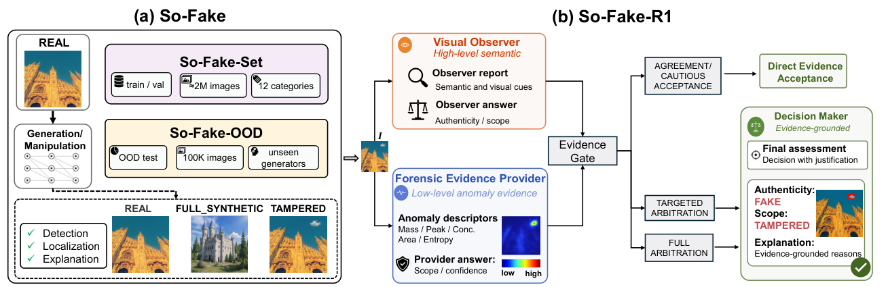
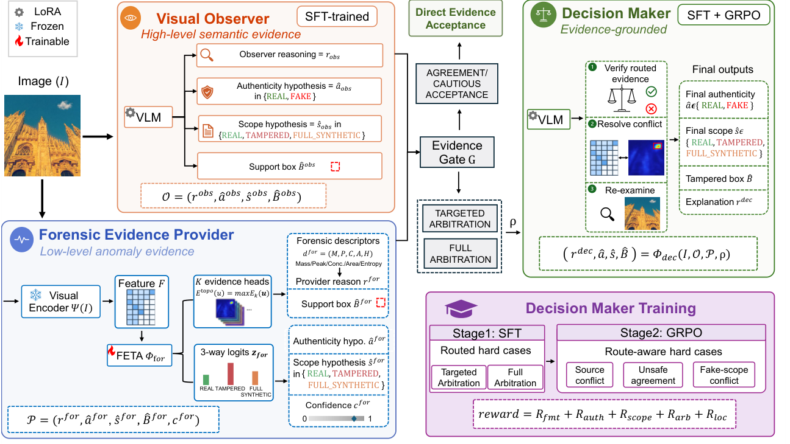
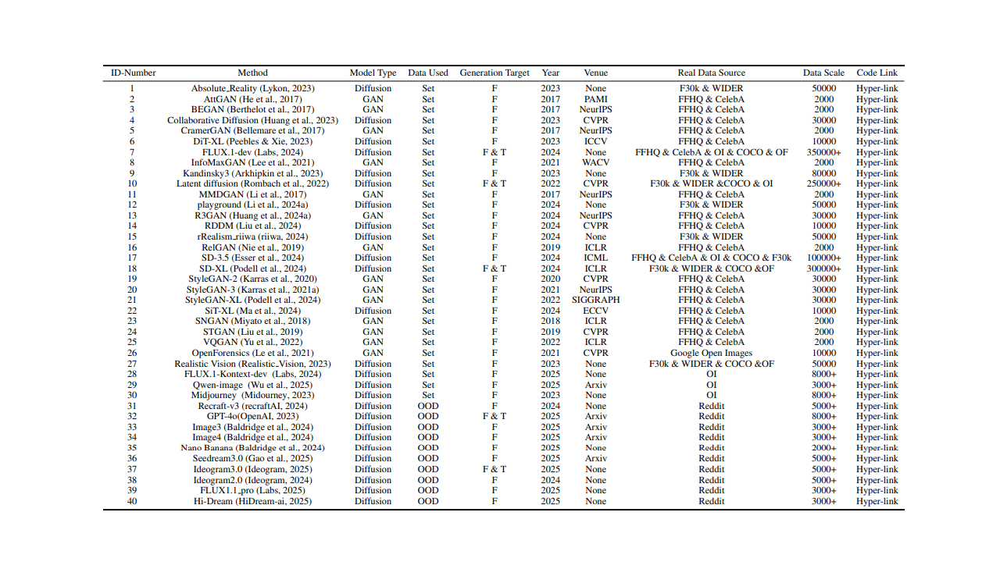
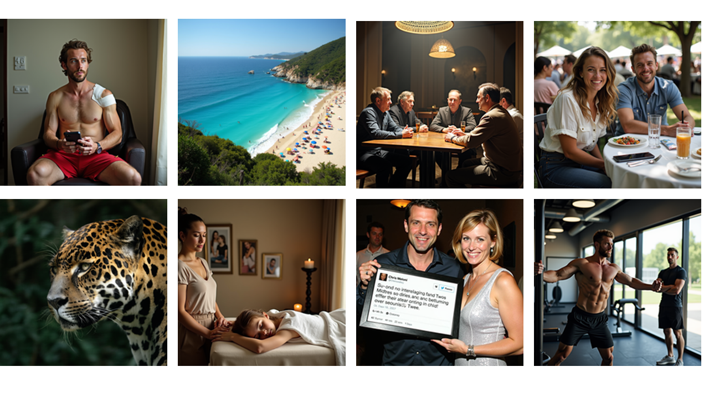
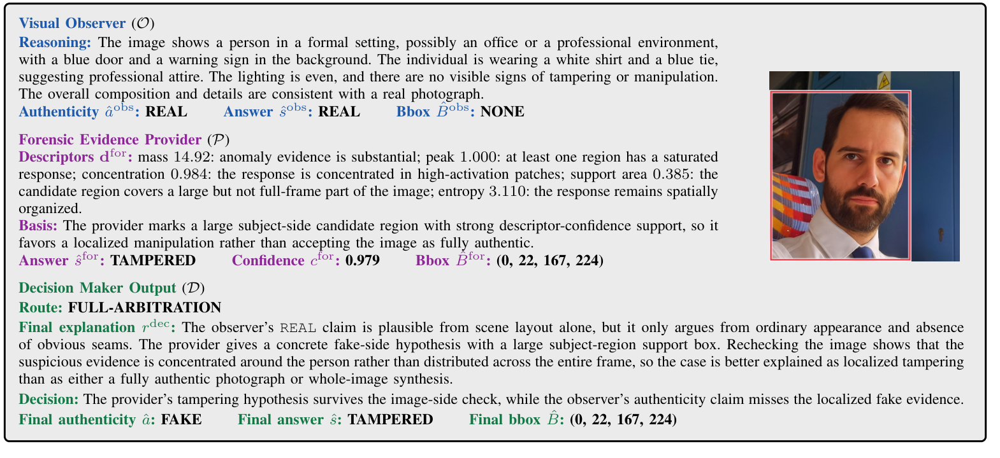

<div align="center">
<h3> So-Fake: Benchmarking Social-Media Image Forgery Detection </h3>

  <p align="center">
    <a href='https://arxiv.org/abs/2505.18660'>
       </a>
    <a href='https://hzlsaber.github.io/projects/So-Fake/'  style='padding-left: 0.5rem;'>
       </a>
    <a href='https://huggingface.co/saberzl/So-Fake-R1' style='padding-left: 0.5rem;'>
       </a>
    <a href='https://huggingface.co/datasets/saberzl/So-Fake-Set' style='padding-left: 0.5rem;'>
      
  </p>
</div>


[Zhenglin Huang](https://scholar.google.com/citations?user=30SRxRAAAAAJ&hl=en&oi=ao),
[Xiangtai Li](https://lxtgh.github.io/),
[Xi Yang](https://scholar.google.com/citations?user=ddfKpX0AAAAJ&hl=zh-CN),
[Bei Peng](https://beipeng.github.io/),
[Xiaowei Huang](https://cgi.csc.liv.ac.uk/~xiaowei/),
[Baoyuan Wu](https://sites.google.com/site/baoyuanwu2015/home),
Dacheng Tao,
Ming-Hsuan Yang,
[Guangliang Cheng](https://sites.google.com/view/guangliangcheng/homepage)


Welcome to **So-Fake**, a benchmark and evidence-grounded framework for social-media image forgery detection.

In this work, we propose: 

> ✅ **One Dataset:** **So-Fake-Set**, a large-scale training/validation corpus with approximately **2M** images across **12** semantic categories and three authenticity scopes: **REAL**, **FULL_SYNTHETIC**, and **TAMPERED**.
> 
> ✅ **One Benchmark:** **So-Fake-OOD**, a **100K** held-out OOD benchmark with authentic images from Reddit, X, Instagram, Bluesky, and Tumblr, and forgeries from disjoint commercial generators.
> 
> ✅ **One Method:** **So-Fake-R1**, an evidence-grounded framework that combines semantic observation, forensic anomaly evidence, an evidence gate, and selective Decision Maker arbitration.
> 


## Abstract
Generative models now produce synthetic images that are increasingly difficult to distinguish from authentic social-media content, threatening information integrity and public trust. Robust mitigation requires both representative benchmarks and reliable detectors, yet existing resources often lack broad social-media content, recent high-fidelity generators, joint protocols, and dedicated OOD evaluation.

We introduce **So-Fake**, a comprehensive benchmark for social-media image forgery detection. **So-Fake-Set** provides approximately **2M** training and validation images across **12** semantic categories, spanning authentic images and forgeries generated by diverse synthesis and editing models. **So-Fake-OOD** provides a **100K** held-out benchmark that combines authentic imagery from five social-media platforms with forgeries from disjoint commercial generators, approximating real deployment shifts. Under a unified three-way protocol over **REAL**, **FULL_SYNTHETIC**, and **TAMPERED** images, So-Fake jointly evaluates authenticity detection, tampered-region localization, and explanation in both in-domain and OOD settings.

We further present **So-Fake-R1**, an evidence-grounded framework with three roles: a **Visual Observer** for semantic cues, a **Forensic Evidence Provider** for low-level anomaly evidence, and a **Decision Maker** for selective arbitration. A deterministic evidence gate accepts sufficiently supported evidence directly and routes conflicting or weakly supported cases to the Decision Maker. Extensive experiments establish So-Fake as a challenging benchmark and show that So-Fake-R1 achieves strong OOD detection and localization while providing evidence-grounded explanations.

## News
- 🔥 (01-08-2026) We released the inference code for [So-Fake-R1](sofake_r1/) and model download scripts.
- 🔥 (23-05-2025) We are pleased to announce the release of [So-Fake-OOD](https://huggingface.co/datasets/saberzl/So-Fake-OOD).
- 🔥 (29-10-2025) We are pleased to announce the release of [So-Fake-Set](https://huggingface.co/datasets/saberzl/So-Fake-Set).

## Overview

<div align="left">
  
    <figcaption>
  <strong>(a) So-Fake.</strong> So-Fake comprises So-Fake-Set (train/val) and So-Fake-OOD (test), spanning REAL, FULL_SYNTHETIC, and TAMPERED images for detection, localization, and explanation.
  <strong>(b) So-Fake-R1.</strong> So-Fake-R1 builds complementary Visual Observer and Forensic Evidence Provider records, then uses an Evidence Gate and a Decision Maker to produce the final authenticity label, forgery scope, localization, and explanation.
</figcaption>
</div>

## Dataset Access

We provide the So-Fake datasets and So-Fake-R1 model release through Hugging Face:

1. [So-Fake-Set](https://huggingface.co/datasets/saberzl/So-Fake-Set)
2. [So-Fake-OOD](https://huggingface.co/datasets/saberzl/So-Fake-OOD)
3. [So-Fake-R1 model weights](https://huggingface.co/saberzl/So-Fake-R1)

For platform-policy compliance, X and Instagram samples in So-Fake-OOD are released through source hyperlinks rather than redistributed image files.

## So-Fake-R1 Inference

We provide an inference-only release of So-Fake-R1 under [`sofake_r1/`](sofake_r1/).
It contains the runtime code, one example image, and scripts for downloading the released model weights.

```bash
pip install -r sofake_r1/requirements.txt
python sofake_r1/scripts/download_weights.py
export PY=/path/to/ms-swift-env/bin/python  # optional, if swift is not in default python
bash sofake_r1/scripts/infer_one_image.sh \
  sofake_r1/examples/example.jpg \
  outputs/sofake_r1_example
```

The example run produces the Visual Observer result, Forensic Evidence Provider result, evidence route, Decision Maker output, final label, bbox, and mask path in:

```text
outputs/sofake_r1_example/sofake_r1_single_image_result.jsonl
```

## Method
<div align="left">
    
    <figcaption>
    <strong>So-Fake-R1.</strong> The Visual Observer produces semantic evidence, the Forensic Evidence Provider derives low-level anomaly descriptors and support regions, and the Evidence Gate either directly accepts sufficiently supported records or routes hard cases to the Decision Maker for arbitration.
    </figcaption>

</div>

## Generative Methods

<div align="left">
      <figcaption> Details of generative methods used in constructing <strong>So-Fake-Set</strong> and <strong>So-Fake-OOD</strong>. Column abbreviations: Set = So-Fake-Set, OOD = So-Fake-OOD, F = fully synthetic images, T = tampered images. Real data source abbreviations: F30k = Flickr30k, OI = OpenImages, OF = OpenForensics.
  </figcaption>
    

</div>

## Visual Cases

<div align="center">
  <figure style="margin: 0; padding: 0;">
        <figcaption style="margin-top: 8px;"><strong>Visual Cases of full synthetic images</strong></figcaption>
    
  </figure>
</div>

<div align="center">
  <figure style="margin: 0; padding: 0;">
        <figcaption style="margin-top: 8px;"><strong>Visual Cases of tampered images</strong></figcaption>
    
  </figure>
</div>

## Visual Output

<div align="center">
  <figure style="margin: 0; padding: 0;">
        <figcaption style="margin-top: 8px;"><strong>Complete So-Fake-R1 routed-arbitration example</strong></figcaption>
    
  </figure>
</div>

## Citation 

```
@misc{huang2026sofake,
      title={So-Fake: Benchmarking Social-Media Image Forgery Detection},
      author={Zhenglin Huang and Xiangtai Li and Xi Yang and Bei Peng and Xiaowei Huang and Baoyuan Wu and Dacheng Tao and Ming-Hsuan Yang and Guangliang Cheng},
      journal={arXiv preprint arXiv:2505.18660},
      year={2026}
}
```
